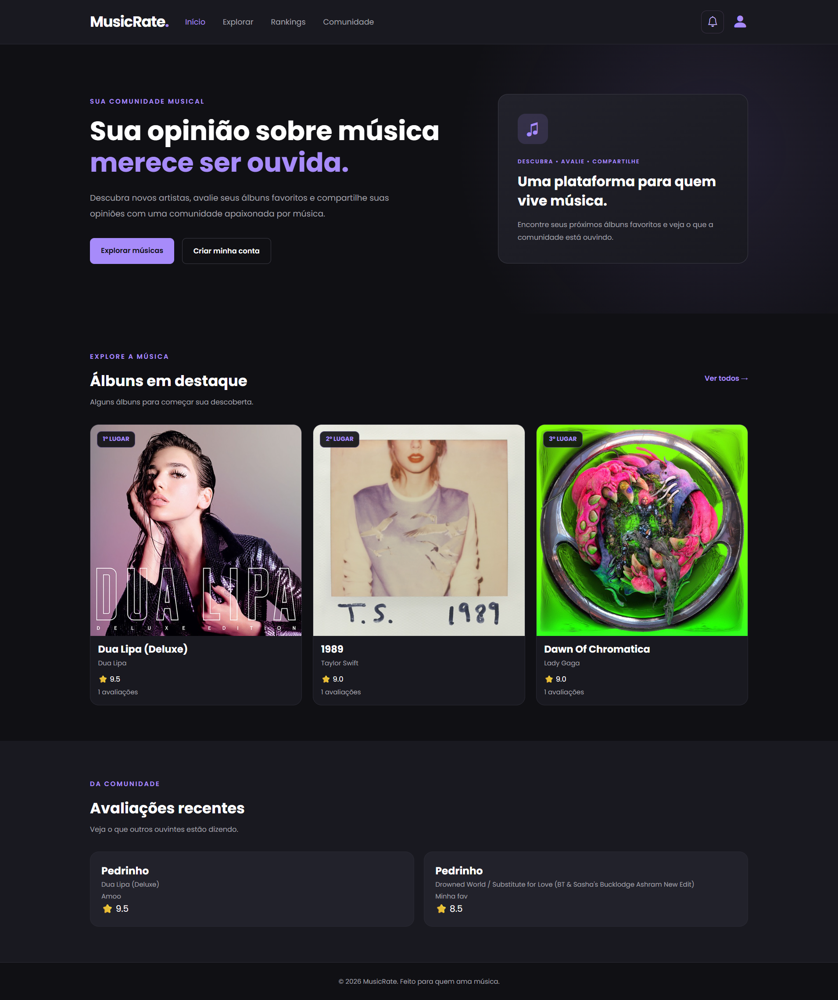
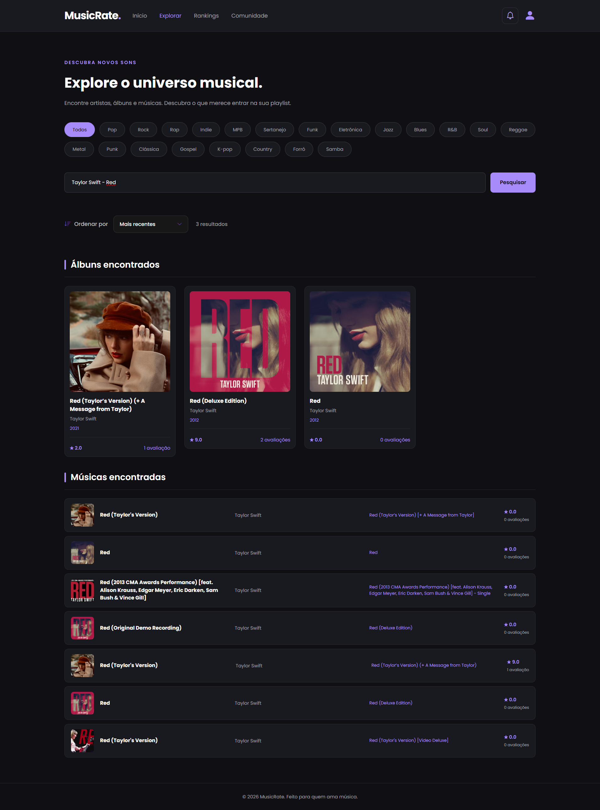
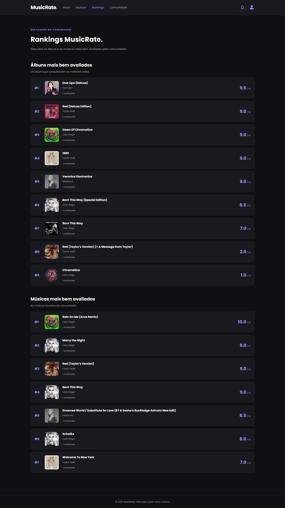
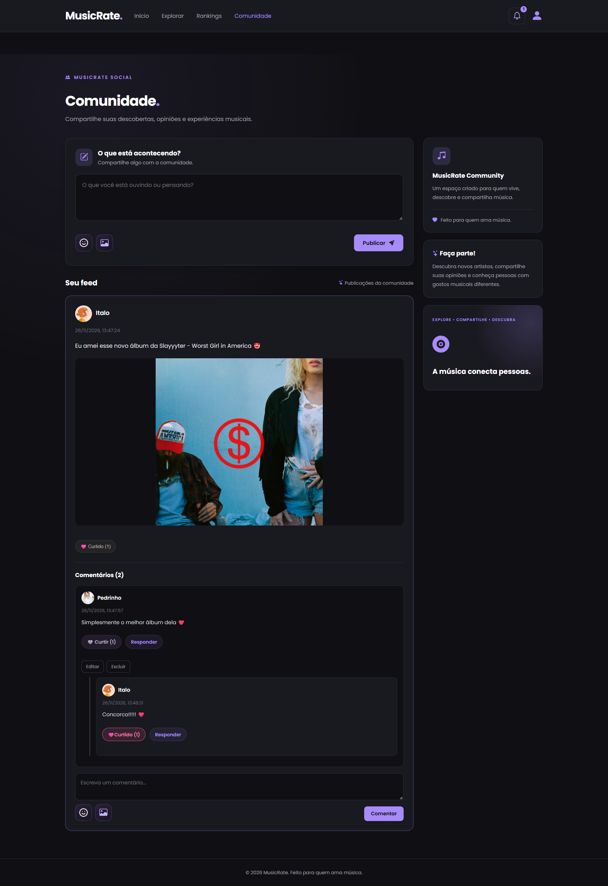

# 🎵 MusicRate

**Descubra, avalie e compartilhe sua paixão pela música!**

O **MusicRate** é uma plataforma de avaliação musical desenvolvida para conectar pessoas por meio da música. Com ela, os usuários podem explorar artistas, álbuns e músicas, registrar suas avaliações, salvar favoritos e interagir com outros membros da comunidade.

O projeto foi desenvolvido utilizando tecnologias web e integração com o Supabase para autenticação, armazenamento e gerenciamento de dados.

---

## ✨ Funcionalidades

### 🎧 Explorar músicas
- Pesquisar artistas, álbuns e músicas.
- Consultar informações musicais utilizando a API do iTunes.
- Visualizar detalhes de álbuns e músicas.
- Explorar conteúdos musicais.

### ⭐ Avaliações e favoritos
- Avaliar álbuns e músicas.
- Editar avaliações realizadas.
- Salvar álbuns e músicas nos favoritos.
- Consultar avaliações armazenadas na plataforma.

### 👥 Comunidade
- Criar, editar e excluir publicações.
- Comentar e responder comentários.
- Curtir publicações e comentários.
- Adicionar imagens às publicações e aos comentários.
- Receber notificações sobre interações.
- Atualizar conteúdos em tempo real.

### 👤 Perfil de usuário
- Criar uma conta e realizar login.
- Gerenciar informações do perfil.
- Adicionar e atualizar foto de perfil.
- Visualizar informações e atividades do usuário.

### 🏆 Rankings
- Página dedicada à apresentação de rankings musicais.

---

## 🛠️ Tecnologias utilizadas

| Tecnologia | Utilização |
|---|---|
| HTML5 | Estrutura das páginas |
| CSS3 | Estilização e responsividade |
| JavaScript | Funcionalidades e interações |
| Supabase | Banco de dados e autenticação |
| Supabase Storage | Armazenamento de imagens |
| Supabase Realtime | Atualizações em tempo real |
| iTunes Search API | Pesquisa de artistas, álbuns e músicas |
| Cloudflare Turnstile | Proteção de login e cadastro |
| Git e GitHub | Versionamento e hospedagem do código |

---

## 📁 Estrutura do projeto

```text
musicrate/
│
├── .gitignore
├── README.md
│
└── frontend/
    │
    ├── assets/
    │   ├── Ellipse 4.webp
    │   └── logo_mini.webp
    │
    ├── css/
    │   └── style.css
    │
    ├── img/
    │
    ├── js/
    │   ├── album-details.js
    │   ├── auth.js
    │   ├── comunidade.js
    │   ├── home.js
    │   ├── music-api.js
    │   ├── notifications.js
    │   ├── profile.js
    │   ├── rankings.js
    │   ├── script.js
    │   ├── song-details.js
    │   └── supabase.js
    │
    ├── pages/
    │   ├── album.html
    │   ├── artista.html
    │   ├── cadastro.html
    │   ├── comunidade.html
    │   ├── explorar.html
    │   ├── login.html
    │   ├── musica.html
    │   ├── perfil.html
    │   ├── rankings.html
    │   └── song-details.html
    │
    └── index.html
```

---

## 🚀 Como executar o projeto

### 1. Clone o repositório

```bash
git clone https://github.com/italoacontato/musicrate..git
```

### 2. Abra a pasta do projeto

```bash
cd musicrate..
```

### 3. Abra o projeto no VS Code

```bash
code .
```

### 4. Execute a aplicação

Utilize a extensão **Live Server** do Visual Studio Code para abrir o arquivo:

```text
frontend/index.html
```

O projeto será executado no navegador.

**Observação:** para utilizar os recursos de autenticação, banco de dados e armazenamento, é necessário ter um projeto Supabase configurado e as credenciais correspondentes no arquivo `frontend/js/supabase.js`. A proteção CAPTCHA também depende da configuração do Cloudflare Turnstile.

---

## 🔐 Segurança

O projeto utiliza políticas de segurança do Supabase (Row Level Security — RLS) para controlar o acesso aos dados.

As credenciais utilizadas no frontend devem ser exclusivamente públicas, como a chave `publishable` do Supabase. Chaves administrativas e secretas nunca devem ser disponibilizadas no código do navegador.

---

## 🎯 Objetivo do projeto

O MusicRate foi desenvolvido como projeto de estudo e portfólio, com o objetivo de aplicar conhecimentos de desenvolvimento web, integração com APIs, banco de dados, autenticação de usuários e funcionalidades de interação social.

---

**Desenvolvido com 🎵 e dedicação.**





